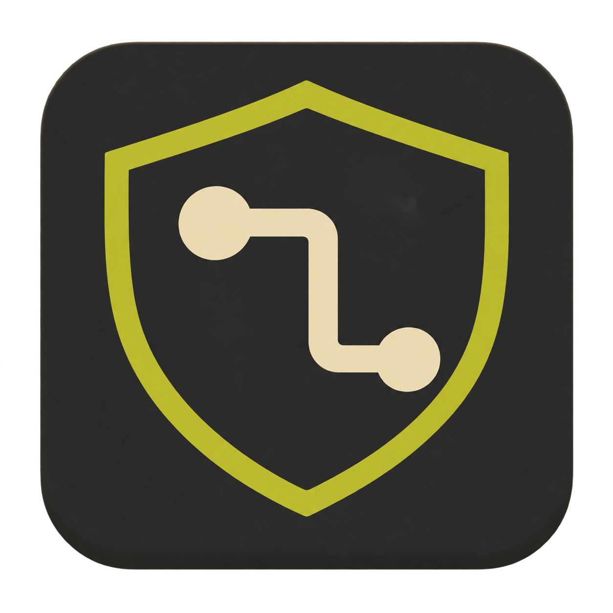
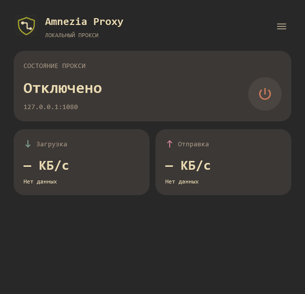
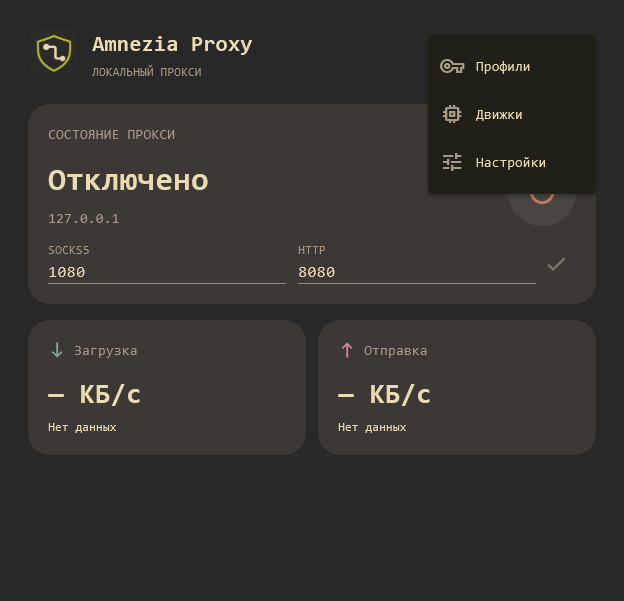
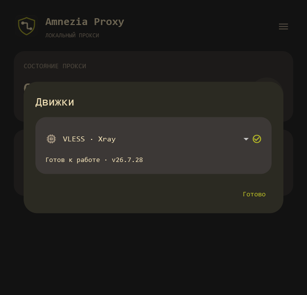
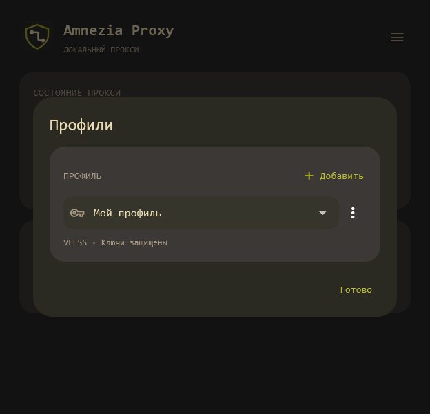
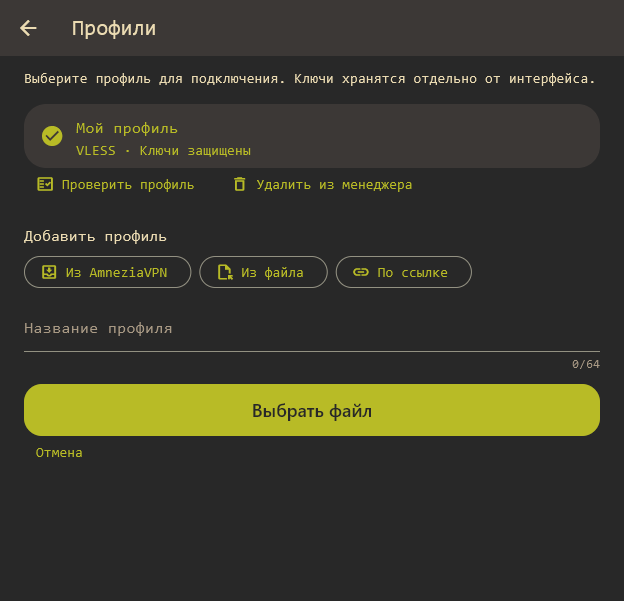
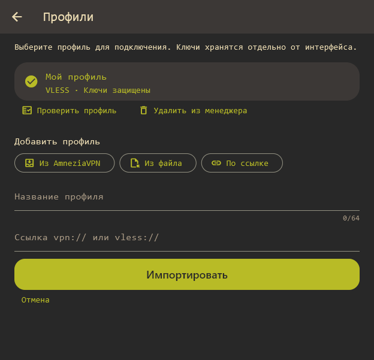
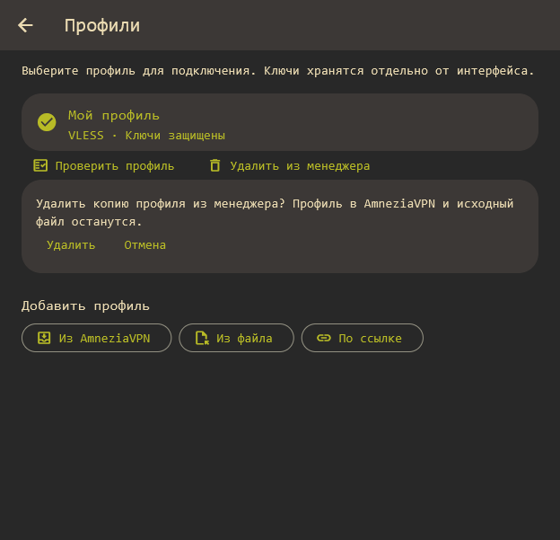
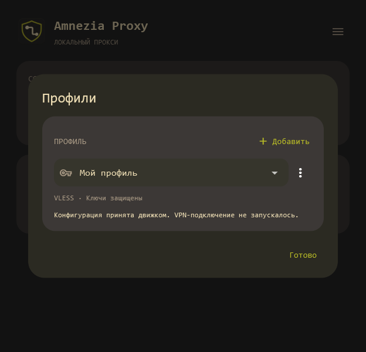
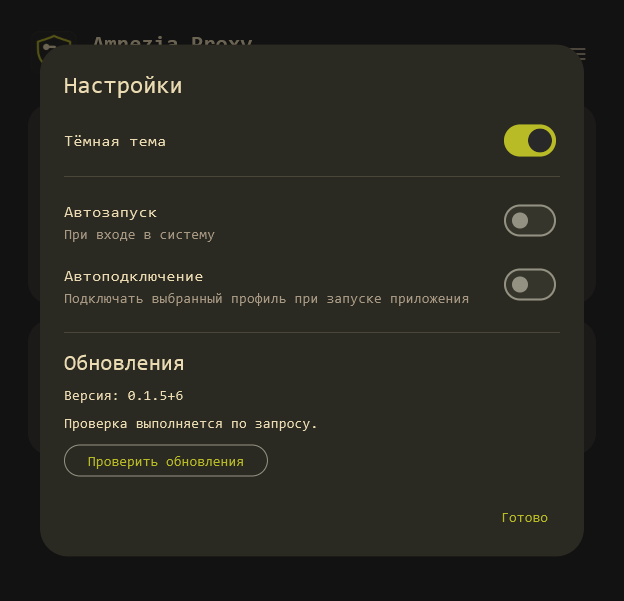

# Amnezia Proxy Manager



Кроссплатформенный Flutter Desktop интерфейс для локального SOCKS5/HTTP-прокси через AmneziaWG или VLESS. Целевые ОС: Windows, macOS и Linux; оформление Gruvbox Dark/Light.

**[Скачать последнюю версию](https://github.com/Hecatoncheir/amnezia-proxy-manager/releases/latest)** · [История изменений](Changelog.md) · [План реализации](TODO.md)

Менеджер запускает собственный сетевой движок и предоставляет локальный прокси для браузера и других программ. Для работы нужен действующий клиентский профиль AmneziaWG или VLESS. После импорта AmneziaVPN можно закрыть: соединением управляет сам менеджер.



Скриншоты сделаны в Windows. «Мой профиль» — демонстрационный профиль без реальных ключей. Для снимков окно увеличено; начальный размер приложения — 540×540, размер и положение запоминаются.

## Содержание

- [Установка](#установка)
- [Первый запуск](#первый-запуск)
- [Выбор и загрузка движка](#выбор-и-загрузка-движка)
- [Добавление профиля](#добавление-профиля)
- [Подключение и отключение](#подключение-и-отключение)
- [Выбор локальных портов](#выбор-локальных-портов)
- [Настройка браузера и других программ](#настройка-браузера-и-других-программ)
- [Автозапуск и автоподключение](#автозапуск-и-автоподключение)
- [Обновление приложения](#обновление-приложения)
- [Частые вопросы и ошибки](#частые-вопросы-и-ошибки)
- [Что проверено и какие есть ограничения](#что-проверено-и-какие-есть-ограничения)
- [Разработка и техническая документация](#разработка-и-техническая-документация)

## Установка

Откройте [GitHub Releases](https://github.com/Hecatoncheir/amnezia-proxy-manager/releases/latest) и выберите пакет для своей системы:

| Система | Файл | Что сделать |
| --- | --- | --- |
| Windows x64 | `AmneziaProxyManager-Setup-windows-x64.exe` | Запустить Setup и установить приложение |
| macOS, Apple Silicon | `AmneziaProxyManager-macos-arm64.dmg` | Открыть DMG и перенести приложение в Applications |
| Linux x64 | `AmneziaProxyManager-linux-x64.run` | Запустить установщик командой ниже |

**Windows.** Установка выполняется для текущего пользователя, обычно в `%LOCALAPPDATA%\Programs\AmneziaProxyManager`. Обновление можно устанавливать поверх предыдущей версии. Для переносимого запуска распакуйте `AmneziaProxyManager-v…-windows-x64.zip` целиком и запустите `amnezia_proxy_manager.exe`: папка `data` и библиотеки должны оставаться рядом.

**macOS.** В текущем выпуске есть пакет arm64 для Apple Silicon; отдельного пакета для Intel Mac нет. Пакеты пока не имеют доверенной подписи издателя/notarization, поэтому ОС может дополнительно ограничивать запуск.

**Linux.** В каталоге со скачанным файлом выполните:

```sh
sh ./AmneziaProxyManager-linux-x64.run
```

Установщик размещает приложение в `~/.local/opt/amnezia-proxy-manager` и создаёт пункт меню. При необходимости запустите его командой:

```sh
~/.local/bin/amnezia-proxy-manager
```

Нужны GTK 3 и стандартные библиотеки C++. Для постоянного хранения профилей также требуются libsecret и доступная системная ключница Secret Service, например GNOME Keyring или совместимая настройка KWallet. Пакеты и настройка ключницы зависят от дистрибутива.

## Первый запуск

Рекомендуем сначала настроить **официальное приложение AmneziaVPN**:

1. Установите AmneziaVPN с [официального сайта](https://amnezia.org/).
2. Добавьте своё подключение, выберите AmneziaWG или VLESS и подключитесь.
3. Убедитесь, что интернет и нужные сайты работают через AmneziaVPN. При этом приложение сохранит рабочую клиентскую конфигурацию на компьютере.
4. Отключите AmneziaVPN и запустите Amnezia Proxy Manager под той же учётной записью.
5. Нажмите круглую кнопку подключения в менеджере. Он попробует получить сохранённый профиль, сам скачает и проверит нужный движок, затем запустит локальный прокси.
6. Укажите этот локальный прокси в браузере или другой программе, как описано ниже.

После успешного импорта и подключения **AmneziaVPN больше не нужно запускать для повседневной работы менеджера**: он использует собственный движок и свою защищённую копию профиля. AmneziaVPN может понадобиться снова, если параметры подключения изменятся или потребуется обновить исходную конфигурацию; после этого повторите импорт. Менеджер поддерживает чтение стандартных хранилищ Windows, Linux и macOS. На macOS может потребоваться разрешение доступа к Связке ключей. Если версия или способ установки AmneziaVPN не поддерживаются, используйте экспорт файла или ссылки.


Если AmneziaVPN уже настроена, можно начать с двух действий:

1. Запустите менеджер. При первом запуске он попробует найти выбранный сохранённый профиль установленной AmneziaVPN под текущей учётной записью.
2. Нажмите **круглую кнопку питания**. Если профиль найден, менеджер сам проверит совместимый движок, скачает его при необходимости, проверит конфигурацию, сохранит собственную копию в защищённом хранилище и запустит прокси.

Во время загрузки на главном экране показывается процент, затем — проверка и установка. Для скачивания нужен доступ к GitHub. Повторное нажатие отменяет подключение: уже начатая подготовка движка может завершиться, но соединение после отмены не запустится.

Автопоиск выполняется однократно и не заменяет ваши сохранённые профили. Если профиль не найден, добавьте его через **☰ → Профили → Добавить**. Если локальное чтение недоступно, используйте файл или ссылку. Если AmneziaVPN ещё не сохранила рабочую конфигурацию, подключитесь в ней один раз, затем выполните ручной импорт **Из AmneziaVPN**. Перед подключением в менеджере отключите исходную AmneziaVPN.

При ручном импорте недостающий движок также скачивается автоматически. В случае недоступности GitHub, неподдерживаемого профиля или ошибки ключницы будет показана причина; ручные разделы «Профили» и «Движки» остаются доступны.

После запуска прокси укажите его в браузере или другой программе: **SOCKS5 `127.0.0.1:1080`** либо **HTTP `127.0.0.1:8080`**. Менеджер пока не меняет системный прокси автоматически: трафик направляют через него только настроенные программы.

Все дополнительные действия находятся в меню справа сверху:



## Выбор и загрузка движка

**Зачем нужен движок:** интерфейс хранит настройки и управляет подключением, а движок передаёт сетевой трафик. Он скачивается отдельно; в установщике приложения его нет.

| Ваш профиль | Что выбрать в «Движках» | Движок в v0.1.9 |
| --- | --- | --- |
| AmneziaWG / совместимый профиль WireGuard | **AmneziaWG** | awg-wireproxy v2.1.0 |
| VLESS, в том числе поддерживаемый профиль AmneziaVPN | **VLESS · Xray** | Xray v26.7.28 |

1. Откройте **☰ → Движки**.
2. В раскрывающемся списке выберите протокол своего профиля.
3. Если движок ещё не установлен, нажмите **«Скачать движок …»**.
4. Круговой индикатор покажет процент полученных данных. После скачивания выполняются проверка и установка — дождитесь их окончания.
5. Строка **«Готов к работе · v…»** означает, что движок установлен и прошёл проверку.



Скачивание само по себе не включает прокси. Приложение устанавливает только разрешённые совместимые выпуски и сверяет SHA-256; самая новая версия в репозитории автора может ещё не поддерживаться менеджером. У Xray v26.7.28 стоит upstream-пометка prerelease, но разрешён именно этот закреплённый выпуск, а не любые предварительные версии.

Можно установить оба движка. При выборе или импорте профиля менеджер переключает карточку на нужный протокол. Уже установленный проверенный движок может работать и при недоступной проверке обновлений; для первого скачивания нужен доступ к GitHub.

## Добавление профиля

**Зачем нужен профиль:** он содержит адрес сервера, клиентские ключи и параметры протокола. Одного установленного движка недостаточно.

Откройте **☰ → Профили**. Здесь выбирается профиль для подключения, а кнопка **«Добавить»** открывает способы импорта.





### Из установленной AmneziaVPN

Этот способ позволяет повторно использовать уже сохранённую клиентскую конфигурацию. Менеджер читает выбранный профиль текущего пользователя штатными средствами своей ОС, проверяет его и сохраняет собственную копию. Новая конфигурация Premium через API не создаётся, дополнительный слот не запрашивается.

1. В AmneziaVPN выберите нужное рабочее подключение AmneziaWG или VLESS.
2. Если оно давно не использовалось, подключитесь в AmneziaVPN один раз и убедитесь, что сеть работает: приложение может обновить сохранённую конфигурацию.
3. В менеджере откройте **Профили → Добавить → Из AmneziaVPN**.
4. Дождитесь сообщения об успешной проверке и сохранении. Недостающий движок менеджер скачает и проверит автоматически.
5. Отключите AmneziaVPN, затем подключайтесь круглой кнопкой менеджера.

Постоянно держать AmneziaVPN включённой не требуется. Одновременное использование одного профиля двумя клиентами может приводить к конфликтам. Автоматического обновления скопированного профиля вслед за AmneziaVPN пока нет: если провайдер изменил параметры, повторите импорт.

На Windows локальный импорт проверен с AmneziaVPN 5.0.3.0. Для Linux реализовано чтение стандартного Qt INI, для macOS — CFPreferences и Keychain; настоящие установки AmneziaVPN на этих двух ОС пока не проверены. При отказе доступа или несовместимом формате используйте файл или ссылку. Поддерживаются сохранённые клиентские конфигурации AWG/VLESS; другие протоколы и одна лишь подписка без клиентского конфига не подходят.

### Из файла

1. Экспортируйте **клиентский** профиль из AmneziaVPN, AmneziaWG или своего средства управления сервером. Для Premium раздел «Файлы конфигурации» может быть ограничен условиями подписки.
2. Выберите **Добавить → Из файла**.
3. Введите понятное название, нажмите **«Выбрать файл»** и укажите экспорт.
4. Дождитесь проверки и сохранения.

Принимаются `.conf`, `.vpn`, `.json`: поддерживаемый INI-профиль AWG/WireGuard, клиентский экспорт AmneziaVPN либо Xray JSON с VLESS. Произвольный JSON и административная резервная копия не являются клиентским профилем.

### По ссылке

1. Выберите **Добавить → По ссылке**.
2. Задайте название и вставьте свою ссылку `vpn://…` или `vless://…` целиком.
3. Нажмите **«Импортировать»** и дождитесь результата.



Подписочная ссылка/API-ключ Premium без клиентской конфигурации не заменяет профиль. Ссылки и конфиги могут содержать ключи доступа — храните их как пароли.

### Проверка, хранение и удаление

Меню **⋮** рядом с выбранным профилем содержит два действия:



- **«Проверить»** — повторно проверить синтаксис через установленный движок. Это помогает обнаружить неподдерживаемые параметры, но не подтверждает доступность сервера или действительность учётных данных.
- **«Удалить из менеджера»** — удалить только копию профиля и ключей из этого приложения. Профиль в AmneziaVPN, подписка и исходный файл экспорта остаются.

<details>
<summary>Как выглядит успешная проверка конфигурации</summary>



</details>

Ключи сохраняются в системном защищённом хранилище: Windows Credential Manager с шифрованным контейнером, macOS Keychain, Linux Secret Service. При недоступной ключнице менеджер предлагает явно выбранный временный профиль: он работает только до закрытия приложения и не сохраняется открытым текстом на диск.

Можно хранить до восьми профилей. Размер импортируемого файла или ссылки ограничен 256 КБ; опасные команды и неподдерживаемые поля отклоняются. Подробности форматов: [PROFILES.md](docs/PROFILES.md), [VLESS](docs/XRAY.md), [локальный импорт на трёх ОС](docs/LOCAL-PROFILE-IMPORT.md).

## Подключение и отключение

1. Выберите профиль в **☰ → Профили** и закройте диалог кнопкой **«Готово»**.
2. Нажмите круглую кнопку питания на главном экране.
3. Дождитесь результата запуска и проверки сети.
4. Для отключения нажмите ту же кнопку ещё раз. Во время запуска она позволяет отменить подключение.

| Что показано | Что это означает |
| --- | --- |
| **Отключено**, терракотовая кнопка | Прокси этого экземпляра менеджера остановлен |
| **Подключение…** | Идут подготовка и запуск движка; повторное нажатие отменяет запуск |
| **Прокси запущен** | Локальные входы готовы, но проверка сети ещё выполняется либо не подтвердилась |
| **Подключено**, «HTTPS через прокси проверен» | Стартовый HTTPS-запрос успешно прошёл через SOCKS5 |
| **Отключение…** | Завершается процесс и освобождаются ресурсы |
| **Не подключено** и сообщение ошибки | Запуск не удался или движок завершился; прочитайте причину и повторите попытку |

Движок слушает только локальные адреса `127.0.0.1`. Закрытие менеджера останавливает его соединение. Пока соединение активно, изменение профиля заблокировано — сначала отключитесь.

Стартовая HTTPS-проверка не является непрерывным мониторингом сети. Надпись **«Нет данных»** в карточках скорости пока нормальна: измерение скорости ещё не реализовано и не определяет успешность подключения.

## Выбор локальных портов

На главном экране под состоянием подключения находятся два поля: **SOCKS5** и **HTTP**. По умолчанию это `1080` и `8080`.

1. При отключённом прокси введите нужные порты от `1` до `65535`. Для двух протоколов нужны разные номера.
2. Нажмите галочку **«Сохранить порты»**. Можно сразу нажать подключение: корректные значения сохранятся автоматически перед запуском.
3. Укажите те же порты в расширении браузера или другой программе. Адрес остаётся `127.0.0.1`.

Настройки сохраняются после закрытия приложения и используются при автоподключении. Во время запуска, подключения и остановки поля заблокированы. Если порт занят или ОС не разрешает его открыть, соединение не запустится: выберите другие номера. На Unix порты ниже `1024` могут требовать дополнительных прав — обычно удобнее использовать номера выше этого значения.

## Настройка браузера и других программ

**Зачем это нужно:** после запуска менеджера программа-клиент должна направить трафик в его локальный прокси. Системные маршруты и настройки всех программ автоматически не переключаются.

| Поле в программе-клиенте | SOCKS5 | HTTP-прокси |
| --- | --- | --- |
| Тип | SOCKS5 | HTTP; для HTTPS используется CONNECT |
| Сервер / хост | `127.0.0.1` | `127.0.0.1` |
| Порт | `1080` | `8080` |
| Логин и пароль локального прокси | Оставить пустыми | Оставить пустыми |

Это локальные параметры менеджера, а не адрес VPN-сервера из профиля. В таблице указаны порты по умолчанию. Если изменили их на главном экране, укажите новые значения. Выберите один тип, поддерживаемый вашей программой. Публикация прокси в локальную сеть не предусмотрена.

### Пример: Firefox

1. Подключите профиль в менеджере.
2. В настройках Firefox найдите раздел настройки прокси/соединения; расположение зависит от версии браузера.
3. Откройте ручную настройку прокси.
4. Укажите SOCKS-хост `127.0.0.1`, порт `1080` и версию SOCKS5. Альтернатива — HTTP-прокси `127.0.0.1:8080`, включая его использование для HTTPS.
5. Сохраните настройки и откройте сайт. Для разрешения имён через SOCKS включите соответствующий параметр клиента, если он доступен.
6. После отключения менеджера верните прежний режим прокси в Firefox, если хотите продолжать работу без него.

Общий порядок ручной настройки описан в [официальной справке Firefox](https://support.mozilla.org/en-US/kb/connection-settings-firefox). В других программах ищите поля «Прокси», «SOCKS5» или «HTTP proxy». Если программа использует только системный прокси, его нужно настроить отдельно.

### Проверка из терминала

При подключённом менеджере можно проверить отдельный запрос. В PowerShell используйте `curl.exe`, чтобы не попасть на одноимённый псевдоним:

```powershell
curl.exe -I --max-time 30 --proxy socks5h://127.0.0.1:1080 https://example.com/
curl.exe -I --max-time 30 --proxy http://127.0.0.1:8080 https://example.com/
```

На macOS/Linux используйте те же команды с `curl` вместо `curl.exe`. Успешный ответ сервера, например HTTP 200, подтверждает работу этого запроса. `socks5h` передаёт разрешение имени прокси; настройки DNS других программ проверяются отдельно. Если у вас настроена переменная `NO_PROXY`, убедитесь, что тестовый адрес не исключён из проксирования.

## Автозапуск и автоподключение

Откройте **☰ → Настройки**. Все переключатели по умолчанию выключены.



| Настройка | Для чего включать | Что произойдёт |
| --- | --- | --- |
| **Автозапуск** | Чтобы не открывать менеджер вручную после входа в ОС | Приложение зарегистрируется в автозагрузке текущего пользователя |
| **Автоподключение** | Чтобы не нажимать кнопку питания при каждом запуске | При следующем запуске приложение попробует подключить выбранный профиль |
| **Автозапуск свёрнутым в трей** | Чтобы менеджер работал без открытого окна при входе в ОС | Включит автозапуск и при входе в систему оставит только значок приложения в трее |

Автозапуск и автоподключение независимы. Только автозапуск открывает приложение без обязательного подключения. Только автоподключение срабатывает, когда вы запускаете менеджер вручную. Включите оба, если нужно открывать менеджер и подключать прокси при входе в систему.

Через значок в трее доступны **«Открыть»**, **«Свернуть в трей»** и **«Выйти»**. Сворачивание не отключает прокси, выход завершает соединение. Обычный запуск ярлыком открывает окно; настройка скрытого старта относится именно к автозапуску при входе в ОС. Если трей недоступен, окно остаётся видимым. На Linux требуется панель со StatusNotifier/AppIndicator; в GNOME она зависит от расширения окружения.

Перед включением автоподключения установите движок, выберите рабочий профиль и проверьте ручное подключение. Отсутствующий движок скачивается автоматически; ошибка подготовки или подключения будет показана на главном экране. Изменение переключателя относится к следующему запуску, текущее соединение управляется круглой кнопкой.

Автозапуск относится к входу пользователя в систему, а не к работе VPN до входа в учётную запись. При переносе portable-копии повторно зарегистрируйте путь, выключив и включив автозапуск. Подтверждённые платформенные сценарии перечислены [ниже](#что-проверено-и-какие-есть-ограничения).

## Обновление приложения

1. Откройте **☰ → Настройки** и прокрутите до раздела **«Обновления»**.
2. Нажмите **«Проверить обновления»**. Проверка выполняется по запросу.
3. Если есть новая стабильная версия, прочитайте описание и скачайте пакет.
4. Дождитесь проверки размера и SHA-256.
5. В установленной Windows-копии нажмите **«Установить и перезапустить»** и подтвердите действие. Приложение закроется, Setup обновит файлы и запустит его снова.

Для переносимой Windows-копии установщик запускается вручную. На macOS интерфейс открывает DMG; замените приложение в Applications. На Linux интерфейс показывает команду для скачанного `.run` — перед её запуском закройте приложение.

Обновление интерфейса и загрузка сетевого движка — разные действия: версией приложения управляет раздел «Обновления», готовностью AWG/Xray — раздел «Движки». Профили хранятся вне каталога установки.

## Частые вопросы и ошибки

| Ситуация | Что сделать и почему |
| --- | --- |
| Менеджер просит скачать движок | При импорте и подключении загрузка выполняется автоматически. Если она не удалась, проверьте доступ к GitHub и повторите попытку через «Движки» |
| Выбранный порт занят или недоступен | Остановите другой локальный прокси или укажите свободные порты на главном экране; после изменения обновите настройки браузера |
| «Прокси запущен», но сеть не подтверждена | Проверьте доступ к серверу и актуальность профиля; открытый локальный порт ещё не означает успешный VPN-трафик |
| Проверка профиля успешна, но подключения нет | Проверка подтверждает синтаксис. Ключи могли устареть, сервер — стать недоступным |
| В AmneziaVPN VLESS работает, в менеджере — нет | Подключитесь в AmneziaVPN, повторно импортируйте её выбранный профиль, затем отключите AmneziaVPN и повторите подключение в менеджере: сохранённая копия могла устареть |
| В Premium ошибка 1108 / превышен лимит конфигураций | Попробуйте импорт уже выбранного сохранённого профиля через «Из AmneziaVPN». Это не запрашивает новую конфигурацию у Premium |
| Файл или ссылка отклонены | Проверьте формат AWG/VLESS, наличие клиентских ключей и выбранный движок. API-подписки, неподдерживаемые протоколы и опасные директивы не импортируются |
| Ключница недоступна | Разблокируйте системную ключницу; в Linux проверьте Secret Service. При необходимости явно выберите предложенный временный режим |
| «Подключено», но браузер работает по старому маршруту | Укажите прокси в самом браузере: менеджер не меняет его настройки автоматически |
| После отключения менеджера браузер перестал открывать сайты | Верните прежние настройки прокси браузера или снова подключите менеджер |
| Удаление профиля затронет AmneziaVPN? | Нет. «Удалить из менеджера» удаляет только собственную копию в менеджере |
| Нужно держать AmneziaVPN включённой? | Нет. После импорта используется собственный движок; AmneziaVPN может понадобиться для обновления исходной конфигурации |
| Почему скорость показывает «Нет данных»? | Счётчики скорости пока не реализованы; смотрите состояние соединения и результат HTTPS-проверки |
| Автозапуск не срабатывает | Проверьте путь установленной/переносимой копии и разрешение в автозагрузке ОС; вход в систему ещё требует отдельной платформенной проверки |

Если нужна помощь, укажите версию приложения, ОС, протокол и текст ошибки. Не публикуйте конфиги, ссылки доступа, приватные ключи и ключ подписки.

## Что проверено и какие есть ограничения

| Платформа | Подтверждено | Ещё требуется проверить |
| --- | --- | --- |
| Windows | Реальный VLESS с HTTPS, запуск/остановка AWG с синтетическим профилем, системное хранение, регистрация автозапуска, автоподключение после перезапуска приложения, установка обновления | Реальная AWG-сеть и автозапуск после выхода/входа или перезагрузки ОС |
| macOS arm64 | Сборка, автоматические тесты и DMG | Нативная VPN-сеть, Keychain, автозапуск/автоподключение, аварийные сценарии и установленная копия |
| Linux x64 | Сборка, автоматические тесты и `.run` | Нативная VPN-сеть, Secret Service, автозапуск/автоподключение и установленная копия |

Приложение предоставляет локальный прокси для настроенных на него программ. Системный VPN/kill switch, полная проверка DNS-утечек и измерение скорости пока не реализованы. Подключение не обеспечивает автоматическую защиту трафика остальных программ. Полные результаты: [VALIDATION.md](docs/VALIDATION.md), [управление сессией](docs/SESSION.md).

## Разработка и техническая документация

[Правила простого кода](AGENTS.md) · [Проверка сложности](docs/CODE-COMPLEXITY.md)

<details>
<summary>Сборка из исходников, архитектура, лицензии движков и выпуск новых версий</summary>

## Техническое состояние

Версия приложения — 0.1.9; реализованы отдельная загрузка движка, импорт AmneziaVPN/AmneziaWG, системное хранение ключей и проверка конфигурации. Есть Flutter runners трёх ОС, темы, установщики, обновление приложения и CI. Подключение AmneziaWG/VLESS управляется круглой кнопкой через Go supervisor. На Windows проверены запуск/остановка и HTTPS через Xray; полный нативный прогон других ОС ещё предстоит.

Сетевой движок — [bropines/awg-wireproxy](https://github.com/bropines/awg-wireproxy), проверенный выпуск **v2.1.0**, ревизия `02588433b6328171b594d76f3f16bd3404258a83`, лицензия ISC. Он загружается отдельно напрямую из GitHub Releases автора. Приложение при запуске предлагает последнюю проверенную совместимую версию, проверяет архив и бинарник по SHA-256, архитектуру и CLI, хранит runtime вне установки. Загрузка и повторный запуск без сети проверены на Windows. Импорт профилей и проверка конфигурации реализованы в M2; подключение из UI и управление процессом реализованы в M3. Подробнее: [аудит M1](docs/UPSTREAM.md) · [схема загрузки движка](docs/ENGINE-RUNTIME.md).

Для VLESS добавлен отдельный [XTLS/Xray-core](https://github.com/XTLS/Xray-core) **v26.7.28**, MPL-2.0. Этот выпуск помечен upstream как prerelease: разрешён только конкретный проверенный тег и закреплённые SHA-256, произвольные предварительные версии не устанавливаются. AWG и Xray имеют отдельные каталоги и проверки. [Интеграция VLESS](docs/XRAY.md).

## Важные ограничения

- Go proxy создаёт отдельный userspace-туннель, а не подключается к активному туннелю AmneziaVPN.
- Доступен импорт выбранного сохранённого профиля установленной AmneziaVPN под текущей учётной записью; Windows проверена с настоящей установкой, для macOS/Linux реализованы стандартные форматы хранения. Подписка не копируется, новая конфигурация Premium не создаётся. Для несовместимых версий остаётся экспорт. [Форматы и хранение ключей](docs/PROFILES.md).
- Это не системный VPN и не системный kill switch. Проксируется только трафик приложений, настроенных на локальный прокси.
- Совместимость экспорта, AmneziaWG-параметров, DNS и IPv6 предстоит проверять на реальных серверах. Повторное использование одного ключа одновременно двумя клиентами может вызвать конфликт.
- Адреса по умолчанию: SOCKS5 `127.0.0.1:1080`, HTTP `127.0.0.1:8080`. Публикация в LAN не предусмотрена.

## Быстрый старт

Требуются Flutter 3.47.7 / Dart 3.13.5 и Go 1.25+ (CI использует Go 1.27.0). Для Windows нужен Visual Studio с Desktop development with C++; для macOS — Xcode; для Linux — clang, CMake, Ninja, pkg-config, GTK 3 development, libstdc++ development, libsecret-1-dev, libx11-dev, libxi-dev; для хранения ключей требуется работающий Secret Service (например GNOME Keyring/KWallet). На Windows плагину хранилища также нужны C++ ATL libraries.

```sh
cd apps/desktop
flutter pub get
flutter analyze
flutter test
flutter build windows --debug
cd ../..
python tools/build_supervisor.py
cd apps/desktop
flutter run -d windows
# На соответствующей ОС: flutter run -d macos / flutter run -d linux
```

```sh
cd engine
go test ./...
go vet ./...
go run ./cmd/proxy-engine --capabilities
go build -o ../build/proxy-engine ./cmd/proxy-engine
```

На Windows используйте имя `proxy-engine.exe`. Команда `--capabilities` возвращает JSON с `canStart: true` и `canValidateConfig: true`; поддерживаются `--inspect-backend` и `--validate-config`. Работающий VPN для этих проверок не требуется.

## Структура

| Путь | Назначение |
| --- | --- |
| apps/desktop/lib | Интерфейс и темы |
| apps/desktop/windows, macos, linux | Нативные runners Flutter |
| apps/desktop/test | Проверка состояния и переключения темы |
| engine/cmd/proxy-engine | Диагностика и безопасная проверка профиля |
| apps/desktop/lib/features/profiles | Импорт, метаданные, системное хранилище и проверка конфигурации |
| engine/internal/upstream | Граница интеграции отдельно собранного backend |
| docs/ARCHITECTURE.md | Компоненты, IPC, безопасность и платформы |
| docs/UPSTREAM.md | Ревизия, стратегия интеграции и лицензирование |
| .github/workflows/ci.yml | Анализ, тесты и сборки трёх ОС |

## Разработка и готовность

Начальный размер окна — 540×540. Размер, положение и развёрнутое состояние
сохраняются между запусками; при отключении монитора окно возвращается в доступную
рабочую область. [Исходник иконки и платформенные размеры](docs/BRANDING.md).

Экран следует концепту Gruvbox: карточки подключения, профиля и скорости, моноширинная типографика и настройки темы. Состояние оформления хранится в одном `SettingsCubit` из `flutter_bloc`; виджеты используют `BlocBuilder`. Тема пока хранится только на время сеанса. Отдельные Bloc/Cubit для ещё не реализованных функций не создаются. Скорость пока отображается как «Нет данных». Круглая кнопка запускает/останавливает выбранный профиль, профили и движки доступны в меню. В настройках есть отдельные переключатели автозапуска и автоподключения (изначально выключены). [Управление сессией](docs/SESSION.md).

[Подробный план и milestones](TODO.md) · [Архитектура](docs/ARCHITECTURE.md) · [Проверки](docs/VALIDATION.md)

Сборка Flutter на каждой ОС выполняется на её собственном runner. CI собирает каркас, но не подтверждает работу VPN. Установщики создаются workflow выпуска по тегу. Реальные профили, ключи и журналы с секретами не должны попадать в Git.

## Выпуски и обновление версии

[История изменений](Changelog.md) · [Подготовка и публикация выпуска](docs/RELEASING.md)

После заполнения `Unreleased` выполните `python tools/release.py prepare v0.1.4`:
команда обновит `pubspec.yaml`, увеличит номер сборки и подготовит раздел changelog.
Отправка тега `v0.1.4` запускает проверки, сборки Windows x64, macOS arm64 и Linux x64,
затем публикацию переносимых архивов, установщиков и SHA-256 в [GitHub Releases](https://github.com/Hecatoncheir/amnezia-proxy-manager/releases).
Предварительные теги вида `v0.1.4-rc.1` создают prerelease. В настройках доступны проверка версии, описание изменений и загрузка с проверкой SHA-256.
Установленная Windows-копия обновляется через Setup с перезапуском; macOS и Linux
показывают пакет и инструкции. Установщики пока не имеют доверенной подписи издателя.

### Обновление скриншотов

Снимки снимаются с настоящего Flutter UI через Flutter Driver. Демонстрационный запуск использует синтетический профиль и настройки в памяти; он читает установленные движки, но не включает прокси. Для воспроизведения сначала установите проверенные AWG/Xray runtimes обычным способом.

```sh
cd apps/desktop
flutter run -d windows -t tool/readme_main.dart
# Во втором терминале подставьте Dart VM Service URI из вывода flutter run:
dart run tool/capture_readme.dart http://127.0.0.1:PORT/TOKEN=/
```

PNG сохраняются в `docs/screenshots`. Перед включением снимков в документацию проверьте, что в кадре только интерфейс и демонстрационные данные.

</details>
